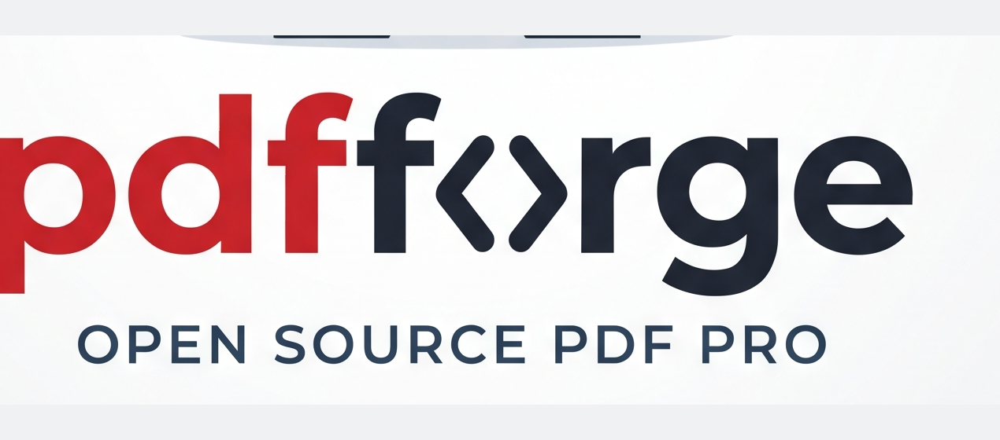

<p align="center">
  
</p>

<h1 align="center">PDF Forge</h1>

<p align="center">
  <b>PDF Forge</b> — a personal, security- and performance-hardened fork of
  <a href="https://github.com/storytold/pdfcraft">PdfCraft</a>.
</p>

> **Fork notice**
>
> PDF Forge is a personal fork of
> [storytold/pdfcraft](https://github.com/storytold/pdfcraft), based on upstream
> **v0.14.0** (upstream had not published a v0.14.1 tag when this fork was
> created). It is **not affiliated with or endorsed by the ArtCraft team**.
> The ArtCraft name, wordmark and logo files have been removed; this fork is
> distributed under the upstream project's MIT OR Apache-2.0 license.

## What PDF Forge changes

### Safety

- Redaction, hidden-information removal and encryption changes now clear the
  undo/redo stacks when saved, so **Undo + Save cannot write removed content
  back** into the file.
- Certification signatures are enforced as a write barrier: DocMDP P=1 refuses
  edits, signing, timestamps and LTV updates; P=2 allows form filling; P=3 also
  allows annotations and links.
- R5/R6 encryption permissions fail closed: a missing or damaged authenticated
  `/Perms` block grants no user permissions instead of trusting editable `/P`.
- Document JavaScript has a 5-second deadline, bounded Boa loop/recursion/operand
  stacks, a smaller worker stack, and a cap on abandoned script workers.

### Memory and hostile input

- Bounded glyph extraction (1M glyphs per page), page rasters (64 MP), soft-mask
  and outline caches, and decoded streams (512 MiB default, page-level budgets
  at call sites).
- Pixel allocation is fallible instead of aborting on allocation failure.
- Named destinations, object-stream caches and object-scan misses are bounded or
  invalidated safely.

### Performance

- Page creation, redaction, preflight, sanitize, OCR and print text-direction
  scans build page/annotation indexes once instead of rebuilding the page tree
  per page or per annotation.
- `RenderPool` can replace its document bytes without recreating worker threads
  and parser state; the canvas re-submits its current demand after a replacement.
- Search and comment refreshes skip needless display/form rewrites, and form
  fields are not enumerated on every comment edit.
- Tiled pages reuse a bounded whole-page surface per worker (pages up to 4 MP)
  instead of interpreting the page for every tile.
- Compare and large redaction searches run off the UI thread; search text is
  bounded by a scanned-page set, and Find updates insert one page's matches
  instead of re-sorting the whole result list.

### Chinese/CJK text

- CJK shaping, fallback and Chinese Add Text support from the local work are
  included. Builds may set `CRAFT_FONTS_DIR` to a `craft-fonts` checkout for the
  optional Japanese/CJK faces; builds without it still compile and run.

### Known limits

- JavaScript still has no hard heap cap; the deadline and runtime limits bound
  time and stack use, but a single very large JS allocation can still exhaust
  memory. Process isolation or an OS-level memory limit would be required for a
  hard guarantee.
- Raster memory is bounded per request/worker/cache, not by one process-wide
  budget.
- The native application and crates keep their original technical names
  (`pdfcraft`, `pdfcraft-cli`, `pdfcraft-*`) so the fork stays build-compatible;
  **PDF Forge** is the fork's user-facing brand.

## Build

The project is a Rust workspace:

```sh
cargo build --release
cargo test
cargo run -p pdfcraft
```

Optional CJK fonts:

```sh
CRAFT_FONTS_DIR=/path/to/craft-fonts cargo build --release
```

The CLI is `target/release/pdfcraft-cli`. The desktop app is
`target/release/pdfcraft`.

## Branch and upstream

This is **PDF Forge 0.14.1**, based on upstream **v0.14.0**. Upstream had not
published a `v0.14.1` tag when this fork was created; the fork's workspace
version records its own next version.

To follow upstream:

```sh
git remote add upstream https://github.com/storytold/pdfcraft.git
git fetch upstream --tags
```

The fork is maintained independently; changes are not automatically proposed
upstream.

## License and attribution

PDF Forge is derived from PdfCraft, Copyright (c) 2026 ArtCraft Team and the
PdfCraft contributors, and is licensed under **MIT OR Apache-2.0** at your
option. See `LICENSE-MIT`, `LICENSE-APACHE`, `NOTICE`, `ATTRIBUTION.toml` and
`ATTRIBUTION.md` for the full notices.

The ArtCraft marks are **not** included in this fork. No ArtCraft logo, wordmark
or brand asset is distributed here; the upstream ArtCraft files in `docs/brand/`
have been replaced with the fork's own `pdf-forge` artwork (see
`docs/brand/LICENSE-brand.txt`).
